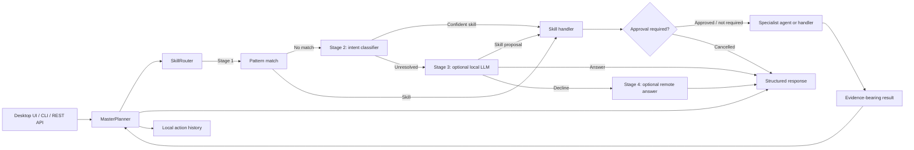

# M.O.N.D.A.Y. — Technical Reference

<div align="center">

Engineering notes for the desktop assistant, its runtime, APIs, ML modules, and
known limitations. For the product overview, start at [README.md](README.md).
For course mapping and assessment evidence, see
[MONDAY_ACADEMIC.md](MONDAY_ACADEMIC.md).

[](https://python.org)
[](https://scikit-learn.org)
[](https://fastapi.tiangolo.com)
</div>

---

## Engineering overview

M.O.N.D.A.Y. combines a Python assistant runtime, specialist agents, a local
desktop UI, an optional REST API, and ML-backed intent/routing capabilities.
This guide covers how those pieces fit together and how to run and test them.

## ML modules

| Module | Technique | Runtime role |
|--------|-----------|--------------|
| [`intent_classifier.py`](ml/intent_classifier.py) | Logistic Regression, KNN, Decision Tree, Random Forest, SVM | Intent classification for command routing |
| [`task_eta_regression.py`](ml/task_eta_regression.py) | Linear, multiple, and polynomial regression | Execution-time estimates for approval prompts |
| [`memory_clustering.py`](ml/memory_clustering.py) | K-Means, DBSCAN, hierarchical clustering, PCA | Organizes memory entries into topics |
| [`association_rules.py`](ml/association_rules.py) | Apriori, FP-Growth | Finds recurring action patterns |
| [`rl_router.py`](ml/rl_router.py) | Epsilon-greedy multi-armed bandit | Learns routing preferences from outcomes |
| [`xai_explainer.py`](ml/xai_explainer.py) | Exact closed-form Shapley values | Explains classifier and regressor predictions |

---

## Folder Structure

```
M.O.N.D.A.Y/
├── app.py                        # Desktop Living Entity Shell launcher
├── cli.py                        # Terminal REPL client
├── harness.py                    # Unified pipeline harness
├── ui/                           # WebGL 3D Living Entity Desktop UI
│   └── index.html                # Audio-reactive WebGL 3D entity & LOD performance controls
├── ml/
│   ├── intent_classifier.py      # Intent classification comparisons
│   ├── task_eta_regression.py    # Task duration prediction
│   ├── memory_clustering.py     # Memory clustering + PCA
│   ├── association_rules.py     # Apriori + FP-Growth comparison
│   ├── rl_router.py             # ε-greedy bandit + comparative report
│   ├── xai_explainer.py         # Exact Shapley attributions
│   └── voice_cloner.py           # Voice profile training & synthesis
├── datagen/                      # Synthetic dataset generators (single source of truth)
│   ├── commands.py               # 2.1 labelled commands (shared vocab + label noise)
│   ├── action_logs.py            # 2.2/2.4/2.5 task + session logs
│   └── generate.py               # `python -m datagen.generate` writes data/synthetic/
├── common/                       # Shared io / metrics / preprocessing helpers
├── core/
│   ├── planner.py                # MasterPlanner — plan, gate, and dispatch
│   ├── security.py               # Tier-1/Tier-2 risk gating + action audit log
│   ├── autonomy.py               # Background proactive daemon
│   ├── task_dag_engine.py        # Multi-step DAG execution
│   ├── router.py                 # Pattern, classifier, and model cascade
│   ├── skills.py                 # Skill catalog and handlers
│   ├── contracts.py              # Typed evidence-bearing results
│   ├── tool_registry.py          # Callable tool catalogue
│   └── config.py                 # Paths & runtime flags
├── agents/                       # Worker agents (browser, comms, computer, document,
│                                 #   memory, coder, voice, vision, habit, public API, audio)
├── api/
│   ├── main.py                   # FastAPI server (agent endpoints, 2.1, /app UI)
│   └── ml_router.py              # /ml/* endpoints for components 2.2–2.5
├── reports/                      # Reproducible evaluation evidence
├── notebooks/                    # Exploratory notebooks
├── tests/                        # Unit + integration suites
├── models/                       # Saved models (created at runtime)
├── data/synthetic/               # Generated datasets (written by datagen/)
├── requirements.txt
├── .env.example
├── README.md                     # Public product overview
├── MONDAY_TECHNICAL.md           # This file
├── MONDAY_ACADEMIC.md            # Course mapping and assessment evidence
└── MONDAY_PRD.md                 # Product Requirements Document
```

## Architecture and execution pipeline

The request router is a cascade, not a single model call:

1. **Patterns** resolve explicit supported commands and typed slots first.
2. **Intent classifier** selects a skill family when the classification is
   confident enough.
3. **Optional local model** (Ollama) runs only when deterministic routing has
   declined. A non-read-only skill guess is proposed for confirmation rather
   than executed.
4. **Optional remote model** is the final answer-only fallback. It is not
   offered a skill schema and cannot dispatch actions.

The selected skill handler performs its task and returns a structured result.
Approval checks are enforced on the applicable action path before irreversible
work. Results flow back to the caller, while the action audit log records
execution events.



`ToolRegistry` is a callable-tool catalogue used by selected features; it is not
the universal dispatch path. `MasterPlanner` routes through `SkillRegistry`,
and invokes the chosen handler after any applicable approval or proposal step.

---

## 🖥️ Living 3D AI Entity Desktop Shell

M.O.N.D.A.Y. features a **Python + WebGL Native Desktop Application Shell (`app.py` & `ui/index.html`)** rendering the living molten gold AI entity in real time:
- **Frameless OS Window**: Borderless window execution (`frameless=True`) with native JavaScript bridge (`DesktopWindowApi`) supporting `✕` close, `—` minimize, and `Esc` keyboard shortcut.
- **Dual Presentation Modes**:
  - **Presence Mode** (Default): Fullscreen 3D WebGL Living Entity with zero app chrome. Entity states (`idle`, `listening`, `thinking`, `speaking`) are communicated 100% visually through an audio-reactive particle field and GLSL Fresnel rim lighting shader. Push-to-talk via Spacebar.
- **Voice — wake word, always-on listening, barge-in**: turn on **Live** (button, or `Ctrl+L`) and say **"Monday, what's the time"**. It keeps listening between commands, acts only on speech addressed to it, and **stops talking the moment you talk over it** — the way Gemini and ChatGPT voice mode behave. All browser-native (Web Speech API); no extra dependency, no network beyond what the recogniser itself uses.
  - Interim recognition results are what make the interruption feel immediate — waiting for a final result is far too late.
  - It ignores its own voice coming back through the microphone, so it does not cut itself off mid-reply.
  - **What it says is not what it prints.** [`core/speech.py`](core/speech.py) derives a short spoken form once, for every surface; the UI reads `execution_result.speech`. Before this, a whole scraped search result was read aloud to the end.
  - **Console Mode**: Full developer diagnostic console with real-time multi-agent execution logs and command input. Toggleable via `Ctrl+``.
- **Multi-Turn Clarification Engine (`pending_clarification`)**: Interactive task pausing, candidate disambiguation, SQLite memory caching, and task resumption. Also carries the Tier-2 approval turn — see below.
- **Tier-2 Approval Gate (PRD §9)**: Irreversible actions stop and ask before executing, quoting the ETA predicted by Component 2.2 (*"Est. 12s — approve?"*). Approval only ever comes from an explicit confirming reply; there is no flag a client can set to skip it.
- **WebGL 3D Engine & LOD Performance Control**: 8,000 particle fields, GLSL Fresnel rim-light core, and torus energy ring. Toggle between High (8,000 p), Balanced (4,000 p), and Battery Saver (1,800 p) with real-time FPS monitoring.

> **Contacts integration is code-complete but inactive.** `agents/comms_agent.py`
> contains working code paths for Google People API (OAuth2) and Outlook MAPI via
> `win32com`, but `googleapiclient`, `google_auth_oauthlib` and `pywin32` are
> neither installed nor declared in `requirements.txt`. Contact resolution
> therefore falls back to local/SQLite lookup. Do not present this as a working
> feature — see [Status & Known Limitations](#status--known-limitations).

---

## Quick Start

### 1. Set up environment

```bash
# From the M.O.N.D.A.Y/ directory
python -m venv .venv

# Windows
.venv\Scripts\activate

# macOS / Linux
source .venv/bin/activate

pip install -r requirements.txt
```

### 2. Copy environment variables

```bash
cp .env.example .env
```

`.env` holds real credentials (SMTP app password, any API keys) and is
gitignored. Never commit it — put placeholders in `.env.example` instead.

### 3. Enable the secret-guard git hook

Run this **once per clone**. Git does not version `.git/hooks/`, so the hook
lives in the tracked `.githooks/` directory and has to be pointed at manually:

```bash
git config core.hooksPath .githooks
```

It refuses any commit that stages a `.env` file or adds a line assigning a real
value to a known secret key (`SMTP_PASSWORD`, `OPENAI_API_KEY`, …) or containing
a recognisable vendor token. Placeholders and `os.getenv(...)` reads pass through
untouched. Offending values are never echoed to the terminal.

### 4. Generate the synthetic datasets

```bash
python -m datagen.generate
```

Writes `data/synthetic/{commands,action_tasks,action_sessions}.csv` — the
documented corpora every ML component trains on. Safe to re-run; it is seeded.

`commands.csv` mixes generated rows with real ones from
`data/external/massive_en_us.csv`, which is committed. Re-deriving that file is a
separate step (`python -m datagen.fetch_massive`) because it downloads 39.5 MB;
nothing here needs the network.

### 5. Run individual ML modules

```bash
# Intent classifier
python -m ml.intent_classifier

# Task ETA regression
python -m ml.task_eta_regression

# Memory clustering
python -m ml.memory_clustering

# Association-rule mining
python -m ml.association_rules

# RL agent router
python -m ml.rl_router

# Explainability
python -m ml.xai_explainer
```

### 6. Start the FastAPI demo server

```bash
uvicorn api.main:app --reload --host 0.0.0.0 --port 8000
```

Then open **http://localhost:8000/docs** for the interactive Swagger UI.

---

## What can it do? — `/help`

Type **`/help`** in the desktop app, the CLI, or `POST /agent/execute` for the
full capability menu. It lists every command category with literal working
examples, marks which actions are Tier-2 gated, and states plainly what needs
setup and is therefore inactive.

```bash
python cli.py          # then type: /help
```

Also accepts `help`, `?`, `commands`, `capabilities`, and `what can you do`. The
match is exact, so `help me summarize report.pdf` summarises the file rather than
printing the menu.

One source of truth: `core.planner.build_help_text()` backs the app, the CLI and
the API, so the menu cannot drift between surfaces. `tests/test_help_command.py`
asserts that every offline example in it actually runs, and that it does not
advertise features the system lacks.

---

## API Endpoints

### ML component endpoints

| Method | Endpoint | Component | Description |
|--------|----------|-----------|-------------|
| `POST` | `/intent/classify` | 2.1 | Classify command intent |
| `POST` | `/ml/eta/predict` | 2.2 | Predict task completion time |
| `GET` | `/ml/memory/clusters` | 2.3 | Memory topic clusters + PCA |
| `GET` | `/ml/workflows/rules` | 2.4 | Top workflow association rules |
| `GET` | `/ml/router/policy` | 2.5 | RL bandit routing policy |
| `GET` | `/ml/clo-map` | — | Academic course mapping reference |
| `GET` | `/xai/explain` | 2.6 | Shapley attribution for a command |

### Agent & system endpoints

| Method | Endpoint | Description |
|--------|----------|-------------|
| `GET` | `/` , `/health` | Health check |
| `GET` | `/app` | Serves the WebGL desktop UI |
| `POST` | `/agent/execute` | Full pipeline: intent → RL route → agent dispatch |
| `POST` | `/agent/computer/organize` | Organise a folder by file extension |
| `POST` | `/agent/computer/screenshot` | Capture the desktop to staging |
| `GET` | `/agent/computer/health` | Live CPU / RAM / disk status |
| `POST` | `/agent/document/summarize` | TF-IDF document summary |
| `POST` | `/agent/browser/search` | Live web search |
| `POST` | `/agent/memory/remember` | Store a memory |
| `POST` | `/agent/memory/recall` | Retrieve memories |
| `POST` | `/agent/voice/train` | Train the voice profile from the reference audio |
| `POST` | `/agent/voice/toggle` | Enable/disable spoken replies |
| `POST` | `/agent/voice/speak` | Speak a phrase |
| `GET` | `/agent/voice/listen` | Listen on the microphone |
| `GET` | `/agent/proactive` | Proactive suggestions |
| `GET` | `/agent/history` | Action audit log |

### Example: Classify Intent

```bash
curl -X POST http://localhost:8000/intent/classify -H "Content-Type: application/json" -d "{\"command\": \"please summarize the quarterly report PDF\", \"confidence_threshold\": 0.65}"
```

Response:
```json
{
  "command": "please summarize the quarterly report PDF",
  "predicted_intent": "document_intel",
  "confidence": 0.8767,
  "llm_fallback": false,
  "confidence_threshold": 0.65,
  "clo": "CLO04",
  "component": "2.1 Intent Classifier"
}
```

### Example: Predict Task ETA

```bash
curl -X POST http://localhost:8000/ml/eta/predict -H "Content-Type: application/json" -d "{\"task_type\": \"browser\", \"agent\": \"browser\", \"step_count\": 7, \"hour\": 14.5}"
```

---

## Validation and evidence

Run the offline regression suite with `py -3.12 -m pytest tests/ -q`. Network
tests are opt-in. Reports, dataset caveats, metrics, and reproducible commands
are indexed in [`reports/EVIDENCE_INDEX.md`](reports/EVIDENCE_INDEX.md); the
course-specific interpretation is in [`MONDAY_ACADEMIC.md`](MONDAY_ACADEMIC.md).

---

## Tech Stack

Core runtime and analysis libraries:

| Library | Version | Purpose |
|---------|---------|---------|
| `scikit-learn` | ≥1.4 | All classical ML (classify, regression, cluster) |
| `pandas` | ≥2.1 | Data manipulation and feature engineering |
| `numpy` | ≥1.26 | Numerical computation |
| `mlxtend` | ≥0.23 | Apriori and FP-Growth |
| `fastapi` | ≥0.111 | Demo REST API server |
| `matplotlib` | ≥3.8 | Evaluation figures |
| `rich` | ≥13.7 | Beautiful console output |

Component 2.6 deliberately has **no** XAI dependency: it computes exact Shapley
values in closed form. See [Status & Known Limitations](#status--known-limitations).

---

## Status & Known Limitations

This status summary distinguishes working features from inactive or unsupported
ones.

### Working and verified

| Area | Status |
|------|--------|
| Components 2.1–2.6 | All run; evidence in `reports/` and `reports/figures/` |
| Intent corpus (2.1) | 17,487 rows, 6,847 of them real (Amazon MASSIVE, Apache 2.0). Held-out macro-F1 0.919; real-command accuracy 1.000 coverage / 0.703 paraphrase — see `reports/real_command_evidence.md` |
| FastAPI engine | 24 endpoints, verified against the live OpenAPI schema |
| Tier-2 approval gate | Enforced for `delete_folder`, `send_email` and `terminate_process` — `core.security.TIER_2_IMPLEMENTED`. See [`reports/CLO01_ethics_and_safety.md`](reports/CLO01_ethics_and_safety.md) |
| WhatsApp | Opens a chat and can pre-type a message; the user presses Enter to send. Automatic sending is not implemented |
| Audit log | Append-only JSON Lines (`data/action_history.jsonl`). Lossless across processes; records the full Tier-2 lifecycle |
| Test suite | Run `py -3.12 -m pytest tests/ -q` for the offline regression suite; network tests are opt-in. Tests are designed to avoid external side effects — see `tests/test_no_side_effects.py` |
| Real-utterance routing | 35.2% of 11,180 MASSIVE utterances reach a skill; reaching a skill does not establish that it is the correct skill. The curated negative-set refusal score is 100% (8/8) — see [`reports/scoreboard.md`](reports/scoreboard.md) |
| Offline start | The UI has no external dependency. Tailwind, three.js and its six add-ons, and both font families are vendored in `ui/vendor/` and served from `/vendor`; re-fetch with `py -3.12 -m ui.vendor.fetch_vendor --write` |
| Voice | Wake word, always-on listening and barge-in, browser-side. **Backend speech and offline transcription** via `voice/tts.py` (Piper → pyttsx3) and `voice/stt.py` (Vosk on raw PCM, no FFmpeg). Both report which engine did the work. The backend is silent by default — the UI speaks — and `cli.py` turns it on |
| Result contract | `core/contracts.py` — a handler may only claim success if it carries evidence of what it did. All 11 agents route through it |
| Skill router | `core/router.py` — patterns → classifier → optional local model → optional remote answer. Unsupported or low-confidence requests are not dispatched. **The substring chain is gone**: `_dispatch_to_agent` was ~520 lines and is now a concise pipeline. Routing accuracy 1.000 (123/123) in the recorded evaluation — [`reports/routing_evidence.md`](reports/routing_evidence.md) |
| News and share prices | `latest_news` reads Google News RSS — top headlines or any topic — and reports the publisher beside each one; it does not summarise articles it has not read. `stock_price` resolves a company name to a ticker through Yahoo's search endpoint (people type "ifci", the quote endpoint wants `IFCI.NS`) and returns the price with its move against the previous close. Both need the network and say so when they cannot reach it |
| Local LLM (optional) | `core/llm.py` — the router's third stage. When enabled and Ollama is available, a local model can answer directly or propose a skill; proposals still pass through routing and approval checks. Disable it with `MONDAY_LLM=off`. |
| Remote LLM (optional) | An explicitly configured remote model can answer ambiguous requests but cannot perform actions. Without a key, or when disabled, it is not used. |
| Streaming | `POST /agent/stream` reports the same pipeline as `/agent/execute` while it runs — `classified` → `consulting_model` → `token` → `result`, heartbeating every 10s. The UI used to abort after 15s, which cancelled every cold model load before it could answer |
| Contacts | A typed `contacts` table, queried exactly. A contact lookup cannot return a conversation transcript, because transcripts are not in that table — the four similarity-search guards remain for numbers taught before it existed |
| Demo | [`DEMO.md`](DEMO.md) is a rehearsed ten-minute script that runs with the Wi-Fi off, and `tests/test_demo_script.py` parses and executes it with sockets blocked |
| Evidence | [`reports/EVIDENCE_INDEX.md`](reports/EVIDENCE_INDEX.md) maps every claim to its artefact and the command that regenerates it; `tests/test_evidence_index.py` checks the paths resolve |

### WhatsApp — what it can and cannot do

WhatsApp has **no API a desktop script may send through**. The official deep link
(`whatsapp://send?phone=…&text=…`) opens the chat with the message already typed
but deliberately will not send it — anti-spam design, not a gap in this code.
That is the whole feature, and it is the only honest one:

| Command | Tier | What happens |
|---------|------|--------------|
| `message 9876543210 saying hi` | 1 | Opens the chat with `hi` **typed in the box**. You press Enter. |
| `whatsapp +919876543210` | 1 | No message text, so it just opens the chat. |

Nothing is transmitted, so nothing is confirmed and nothing is gated.

> **Changed 2026-08-14.** This used to gate on Tier 2 and then simulate the Enter
> keypress. It did not work: an approved send reported "pressed Enter" and
> delivered nothing. `pyautogui.press("enter")` fired after a fixed 8-second
> sleep into whatever window held focus, so a slow WhatsApp launch, a
> notification or one stray click sent the keystroke somewhere else — and
> nothing here can read WhatsApp back to notice. A gate in front of an action
> that does not happen is worse than no gate: it asks you to authorise
> something, then tells you it was done. The path was removed rather than
> reworded, so `send_whatsapp` is no longer in `TIER_2_IMPLEMENTED`.

It reports that the message was **typed**, never that it was sent or delivered.

**Numbers** default to `+91` (set `DEFAULT_COUNTRY_CODE` in `.env` to change),
so a bare 10-digit mobile works. Lengths are validated, not just bounded — a
9-digit number is rejected rather than dialled. Names resolve from saved
contacts (`papa's number is 9876543210`); if a name is unknown, it asks for the
number, saves it, and resumes the message you originally asked for. Contact
lookup carries emails only, so a bare name has no other route to a number.

### Implemented but inactive

- **Google People API / Outlook MAPI contacts** — code exists in
  `agents/comms_agent.py`; `googleapiclient`, `google_auth_oauthlib` and
  `pywin32` are not installed or declared. Falls back to local/SQLite lookup.
- **Voice cloning of the reference sample** — evaluated with Coqui XTTS and
  rejected: Windows Smart App Control blocks the FFmpeg binary XTTS needs to
  decode audio, and disabling it is a one-way system security change. Speech is
  a generic voice instead: `voice/tts.py` tries Piper (if `MONDAY_PIPER_VOICE`
  names a `.onnx`) then `pyttsx3` over Windows SAPI5 — **both offline** — and the
  desktop UI speaks in the browser with `speechSynthesis`. gTTS is in neither
  path; the only remaining reference to it is the abandoned `ml/voice_cloner.py`,
  which the `speak` skill does not call.

### Declared in policy but not implemented

- **Meeting audio capture** — there is no implementation. Nothing in the repo
  records audio, so `AudioSummarizerAgent` now refuses up front instead of
  reporting an empty meeting. It can still summarise a transcript you supply.
- **Screen vision without a Gemini key** — the fallback reports the active window
  title and mean pixel brightness. It does not read the screen, and no longer
  says it does.
- **Voice cloning** — neither gTTS nor pyttsx3 uses `mondayvoice.mp3`; the stored
  "voice profile" holds playback settings, not measured acoustics.
- **IoT / Smart Home ("Pillar 5")** — there is no implementation. The previous
  `toggle_smart_light` performed no I/O and returned success anyway; it now
  reports `NOT_IMPLEMENTED`. Real support needs a hub to talk to (Home Assistant,
  MQTT, or a vendor cloud) and a device to talk about.
- **Reading the system volume** — Windows does not expose it to PowerShell
  without a helper (pycaw, nircmd, AudioDeviceCmdlets), none of which is
  installed. Setting the volume works.

`core/security.py` classifies `delete_file`, `overwrite_file`, `execute_shell`,
`submit_form`, `modify_system_settings` and `kill_process` as Tier 2. **None of
these have an implementation anywhere in the codebase.** The list is a
default-deny policy so that a future implementation is gated from its first
commit — it is not a description of existing capability. `TIER_2_IMPLEMENTED`
names the three that are real.

### Constraints on this machine

- **`shap` cannot be installed.** It hard-imports `numba`; numba 0.66 (the only
  build supporting the `numpy>=2.3.5` that `mlxtend`/2.4 needs) is blocked by
  Smart App Control, and the numba that does load pins `numpy<2.2` and breaks
  `mlxtend`. Component 2.6 computes Shapley values directly instead, and the
  result is verified bit-for-bit identical to `shap.LinearExplainer` —
  see [`reports/2_6_shap_equivalence.md`](reports/2_6_shap_equivalence.md).
- ~~**Some tests depend on live third-party APIs**~~ — FIXED 2026-08-08. The
  default suite runs with `--block-network`: HTTP-dependent tests replay
  recorded cassettes from `tests/cassettes/`, and the four that genuinely need
  the internet are marked `network` and deselected. A red suite now means a code
  regression. Run the live ones deliberately with `py -3.12 -m pytest -m network`
  (expect failures when DuckDuckGo rate-limits this machine — that is the point
  of separating them).
- ~~**No LLM is configured.**~~ — SUPERSEDED 2026-08-16/17. The router has a
  local third stage (`core/llm.py`, via Ollama), and conversation memory across
  turns arrived with it. What this bullet described — a hosted Gemini call in
  `core/planner.py`, gated on an API key — was **removed 2026-08-18**. It ran
  after a dispatch that failed *or* merely one the classifier was unsure about,
  and replaced the result with a generated string marked `success: True`: on any
  machine that had a key, a genuine failure and a stage-3 "shall I?" both became
  fabricated successes. Stage 3 is now the only language model in the routing
  path. The two remaining Gemini paths are code synthesis in
  `agents/coder_agent.py` and document Q&A in `agents/document_agent.py`, both
  still inactive without a key.

---

## License status

The repository currently has no `LICENSE` file. Refer to the public
[README.md](README.md) before reusing or distributing this project.
