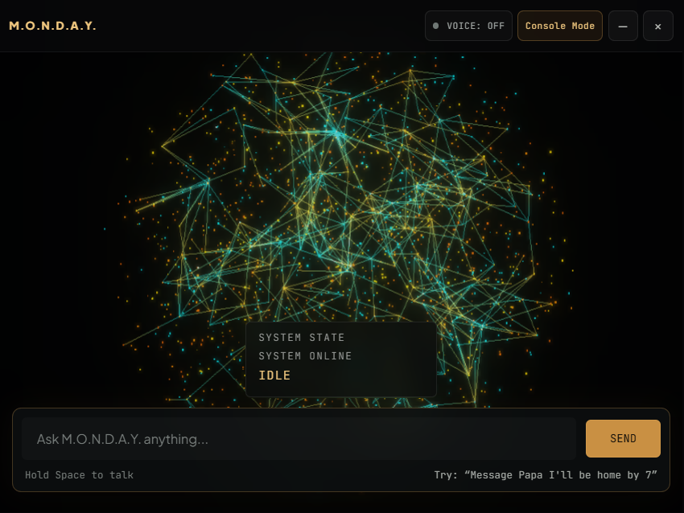
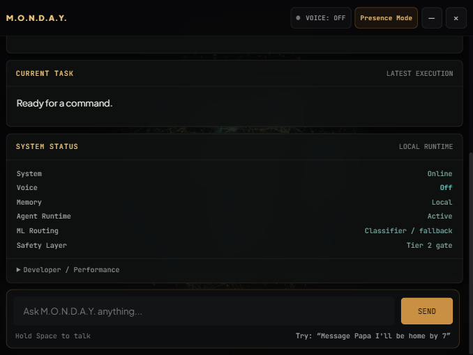
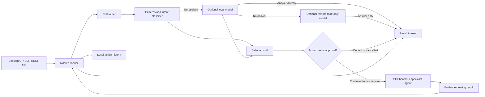

<p align="center">
  
</p>

<h1 align="center">M.O.N.D.A.Y.</h1>
<p align="center"><strong>A desktop assistant that turns requests into actions—with you in control.</strong></p>
<p align="center">
  <a href="https://www.python.org/"></a>
  <a href="https://github.com/sambhav-007/M.O.N.D.A.Y/actions/workflows/ci.yml"></a>
</p>

## Product demo

A public video is not available yet. For a live, network-independent
walkthrough, see the [10-minute demo](DEMO.md).

## What is M.O.N.D.A.Y.?

M.O.N.D.A.Y. is a local-first Windows assistant with a molten-gold, animated
desktop presence. Type or speak a request; specialist agents handle supported
desktop, browser, document, memory, and voice tasks. Actions that can make
irreversible changes pause for explicit approval.

## Screenshots

These are live captures of the running application, not concept art:





## What M.O.N.D.A.Y. can do

- **Talk or type:** Use the desktop interface, command-line client, or REST API.
- **Delegate supported tasks:** Specialist agents cover areas such as desktop
  information, documents, web research, and local memory.
- **See what happened:** Console mode exposes pipeline activity; the Presence
  view displays the assistant's response.
- **Keep control:** Approval-gated actions stop and ask before execution.
- **Run locally:** Core routing and the optional Ollama model run on your
  machine. Web search, browser speech recognition, and optional remote
  integrations may need a network connection.

## Architecture



In short: a request is routed to a supported skill, approval is checked before
gated actions, and the result is returned with execution evidence and an audit
record.

## How it works

1. The desktop UI, CLI, or API sends a request to `MasterPlanner`.
2. The router tries explicit patterns, then a sufficiently confident intent
   classification.
3. If those stages decline, optional local model assistance may select a skill
   or answer directly. A configured remote model can only answer; it cannot
   select or execute a skill.
4. The selected handler runs. Gated actions pause for confirmation, and
   non-read-only model suggestions are proposed rather than run automatically.
5. M.O.N.D.A.Y. returns the result and records the action in local history.

## AI and ML capabilities

The runtime includes six ML modules: five classical ML components plus an
explainability module.

| Module | What it does |
|--------|--------------|
| Intent classification | Routes command language to an intent |
| Task ETA regression | Estimates duration for confirmation prompts |
| Memory clustering | Groups stored memories into topics |
| Association rules | Finds recurring action patterns |
| Reinforcement-learning router | Learns agent-routing preferences from outcomes |
| Explainability (XAI) | Calculates feature attributions for model predictions |

For CLO mapping, datasets, evaluation methodology, and academic evidence, see
[MONDAY_ACADEMIC.md](MONDAY_ACADEMIC.md). The implementation details are in
[MONDAY_TECHNICAL.md](MONDAY_TECHNICAL.md).

## Technology

- **Python** assistant runtime, agents, and ML
- **FastAPI** REST API
- **scikit-learn**, NumPy, pandas, and mlxtend for ML workflows
- **SQLite** for local application data
- **HTML, CSS, JavaScript, and WebGL/Three.js** for the desktop interface

## Install on Windows

1. Install [Python 3.12](https://www.python.org/downloads/) and Git. During
   Python setup, enable the Python launcher if the installer offers that option.
2. Open PowerShell and clone the project:

   ```powershell
   git clone https://github.com/sambhav-007/M.O.N.D.A.Y.git
   cd M.O.N.D.A.Y
   ```

3. Create an isolated environment, activate it, and install dependencies:

   ```powershell
   py -3.12 -m venv .venv
   .\.venv\Scripts\Activate.ps1
   python -m pip install --upgrade pip
   pip install -r requirements.txt
   ```

4. Start the desktop app:

   ```powershell
   py -3.12 app.py
   ```

   If the desktop window is unavailable, the same interface is served by the
   local API at `http://127.0.0.1:8000/app`. Start the API directly with:

   ```powershell
   py -3.12 -m uvicorn api.main:app --host 127.0.0.1 --port 8000
   ```

   Interactive API documentation is at `http://127.0.0.1:8000/docs`.

For a terminal session instead, run `py -3.12 cli.py`.

## Configuration

The default app can be explored without adding API keys. Optional settings are
documented in [.env.example](.env.example). To customize them, copy the file
and edit `.env`:

```powershell
Copy-Item .env.example .env
```

Never commit `.env` or real credentials. Ollama is optional for local language
model assistance; remote model access and SMTP email require separate setup.
See the [technical configuration guide](MONDAY_TECHNICAL.md#quick-start) for
more detail.

## Security and privacy

- The core runtime and local model path can operate on-device.
- Online search, browser speech recognition, SMTP, and a configured remote model
  may send requests or data to their respective providers. Review integrations
  before using them with sensitive information.
- Approval-gated actions require an explicit confirmation; model output does
  not grant permission to execute a gated action.
- Action history is stored locally. Keep credentials in `.env`, which must not
  be committed.

See the [technical guide](MONDAY_TECHNICAL.md#status--known-limitations) and
[product requirements](MONDAY_PRD.md) for implementation details.

## Known limitations

- Browser speech recognition availability and connectivity depend on the
  browser and operating system.
- WhatsApp can open a chat with a message drafted; the user must press Send.
- Google People API and Outlook contacts integrations are present in code but
  inactive without their optional dependencies and setup.
- Meeting-audio capture and voice cloning are not implemented as working
  features.

## Roadmap

See the [community roadmap](ROADMAP.md) for proposed priorities and ways to
shape them. Detailed implementation notes are preserved in
[ROADMAP_ENGINEERING.md](ROADMAP_ENGINEERING.md).

## Contributing

Contributions are welcome. Read [CONTRIBUTING.md](CONTRIBUTING.md) for setup,
testing, and pull request guidance. Please report bugs and propose changes in
[GitHub Issues](https://github.com/sambhav-007/M.O.N.D.A.Y/issues).

## Contributors

- Siddhant Bhatia
- Sambhav Sehgal
- Samarth Sharma
- Shivansh Chandel

## License

No `LICENSE` file is currently present, so the project has not yet declared an
open-source license. A license should be chosen and added before public launch;
do not assume that reuse or redistribution is permitted.
